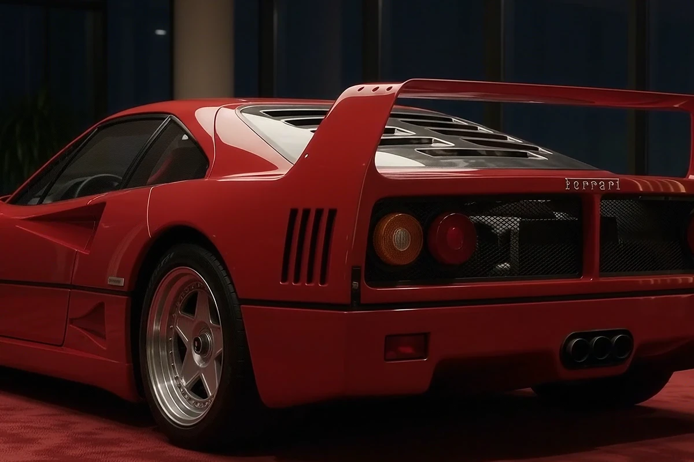

# FERRARI F40 — The Sovereign Unveiling

An ultra-luxury, scroll-driven interactive landing page featuring the Ferrari F40, inspired by high-fashion automotive atelier aesthetics (Valmora style). Built with 60fps canvas frame scrubbing, Lenis smooth scrolling, GSAP choreography, interactive design hotspots, an authentic Veglia Borletti analog tachometer, and a procedural twin-turbo V8 engine sound synthesizer.



## ✨ Experience Features

- **Interactive "Drag to Reveal" Arc**: Draggable luminous arc scrubber that lets visitors physically peel back the crimson silk sheet to reveal the Ferrari F40.
- **Canvas Frame Engine**: 240 pristine high-resolution frames extracted from the official reveal film with full aspect ratio cover scaling.
- **Interactive Design Hotspots**: Pulsing reticles on the pop-up headlamps, Speedline modular wheels, Kevlar monocoque cockpit, and rear wing with detailed zoom cards and sliding timeline tabs.
- **Veglia Borletti Tachometer Dial**: Fully animated analog gauge with brass metallic bezel, redline zone (7,750–9,000 RPM), progressive LED shift lights, and spring needle physics that revs dynamically as you hover or scroll over specifications.
- **Procedural Web Audio V8 Synthesizer**: Zero-dependency procedural audio engine generating flat-plane twin-turbo V8 rumble, turbo spool hiss, and rev bursts.
- **Private Viewing Section**: Warm luxury ivory/parchment transition with bespoke inquiry form and interactive interest pills.
- **Full Multi-Device Responsiveness**: Tailored layouts for desktops, laptops, tablets, and mobile devices.

## 🚀 Quick Start (Local Development)

```bash
# Clone the repository
git clone https://github.com/hariprasad814261/ferrai-scroll-website.git
cd ferrai-scroll-website

# Run locally using Python
python -m http.server 8080

# Or with Node / npx
npx serve .
```

Open `http://localhost:8080/` in your browser.

## 🌐 Deploy to Vercel

This repository includes pre-configured `vercel.json` for instant deployment with CDN asset caching:

[](https://vercel.com/new/clone?repository-url=https%3A%2F%2Fgithub.com%2Fhariprasad814261%2Fferrai-scroll-website)

Or using the Vercel CLI:
```bash
npx vercel
```

## 🛠️ Built With

- **HTML5 & CSS3** (Vanilla CSS with tailored HSL tokens)
- **JavaScript (ES6+)**
- **[Lenis](https://lenis.darkroom.engineering/)** (Smooth momentum scroll)
- **[GSAP & ScrollTrigger](https://greensock.com/)** (Animation choreography)
- **HTML5 Canvas 2D API** (Retina frame rendering)
- **Web Audio API** (Procedural audio synthesis)

---
*Created for Ferrari enthusiasts & automotive connoisseurs.*
